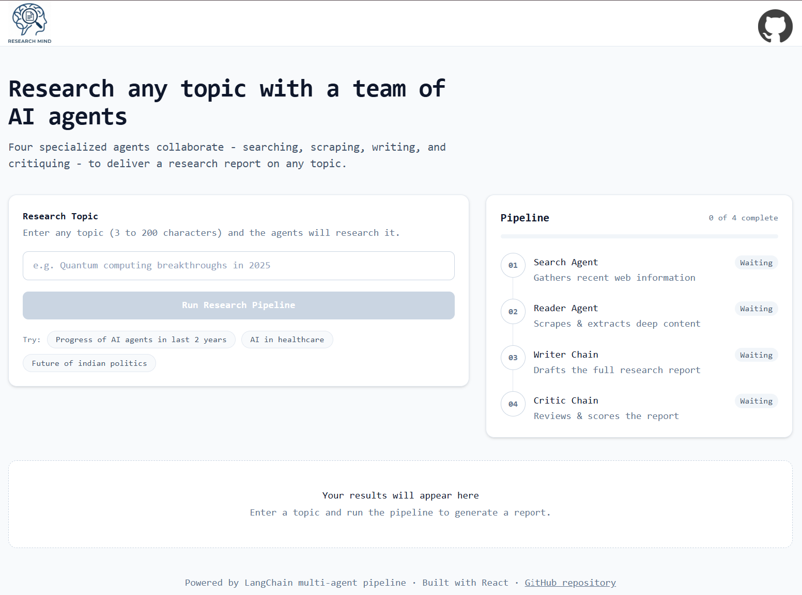
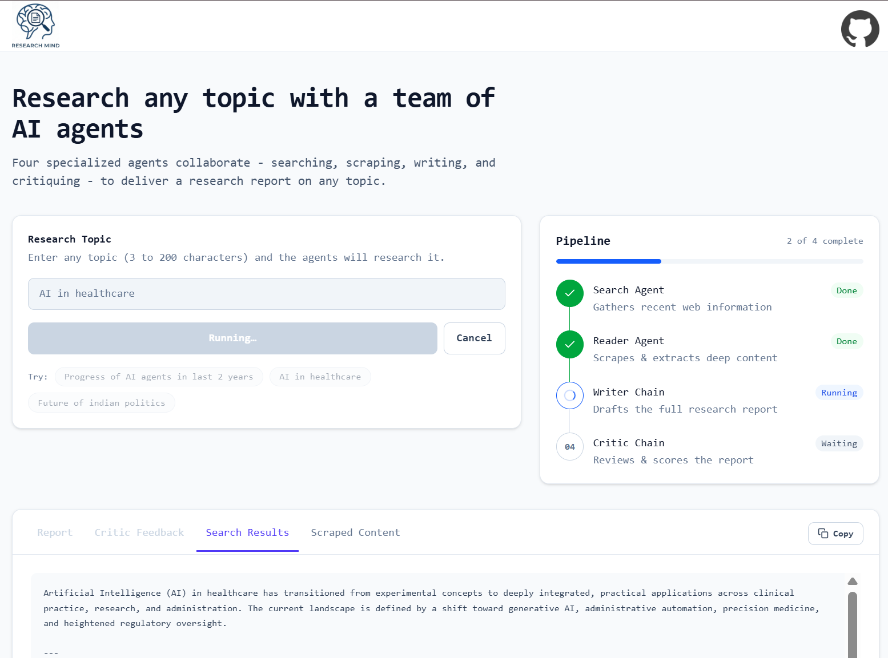
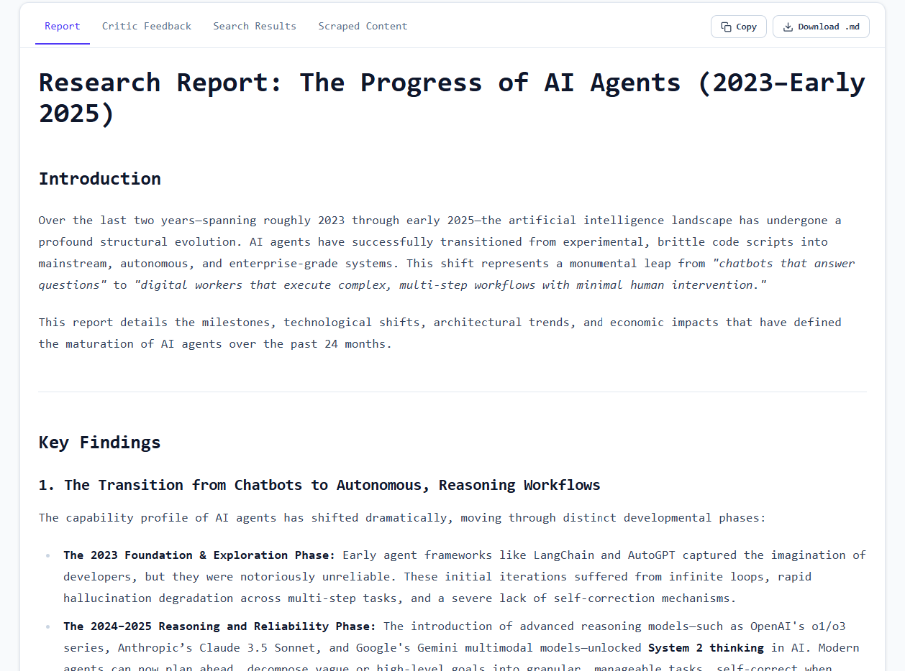
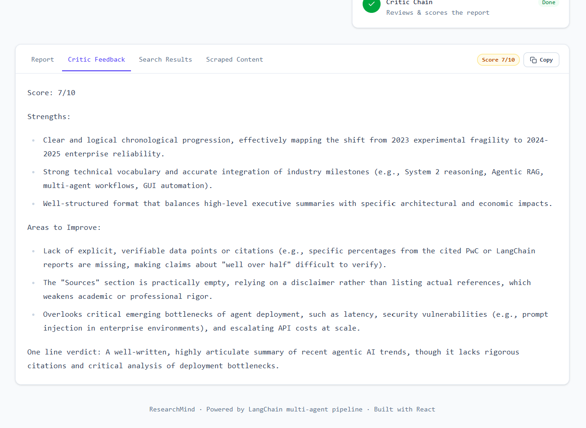
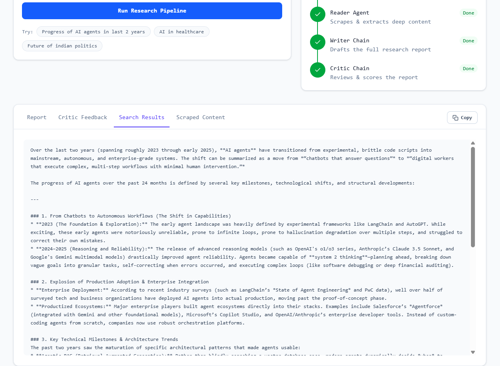
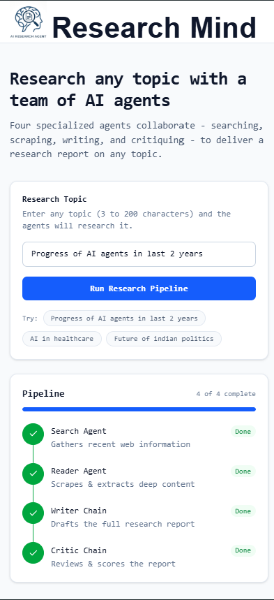
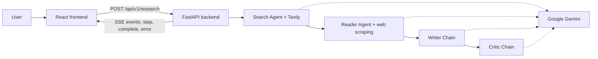

# ResearchMind - Multi-Agent Research System

ResearchMind takes a research topic and produces a structured report using four AI agents that work one after another. The React frontend shows each step live as it runs, and the FastAPI backend streams progress to it.

## Demo

| Home | Pipeline running |
|---|---|
|  |  |

| Final report | Critic feedback |
|---|---|
|  |  |

| Raw search results | Mobile view |
|---|---|
|  |  |

<details>
<summary>API documentation (FastAPI /docs)</summary>


</details>

## Core Idea

Instead of asking one LLM to "research and write everything" in a single prompt, the work is split into focused roles:

1. **Search Agent** - searches the web for recent, reliable information on the topic.
2. **Reader Agent** - picks the most relevant URL from the results and scrapes it for deeper content.
3. **Writer Chain** - combines the search results and scraped content into a structured report.
4. **Critic Chain** - reviews the report and gives a score, strengths and improvements.

Each stage has one job, which keeps prompts short and makes each output easy to inspect.

## Features

- Four-stage multi-agent pipeline (search, read, write, critique)
- Live progress: each step moves from Waiting to Running to Done as the backend finishes it, streamed with Server-Sent Events (SSE)
- Results appear as soon as their step finishes, in tabs: Report, Critic Feedback, Search Results, Scraped Content
- Report rendered as Markdown, with Copy and Download (`.md`)
- Critic score badge (when the critic gives a score out of 10)
- Cancel a run in progress
- Clear error messages for validation problems and pipeline failures
- Responsive layout for desktop and mobile
- Automatic API docs at `/docs`

## Architecture



The frontend sends the topic with a POST request and reads the response as a stream. The backend sends a `step` event when each stage starts and finishes, then a final `complete` event (or an `error` event if something fails).

## Tech Stack

| Area | Technology |
|---|---|
| Frontend | React 19, Vite, Tailwind CSS v4, react-markdown |
| Backend | Python 3.12, FastAPI, Uvicorn, Pydantic |
| LLM | Google Gemini (`gemini-3.5-flash-lite`) via LangChain `init_chat_model` |
| Orchestration | LangChain (`create_agent`, prompt templates, output parsers) |
| Web search | Tavily |
| Web scraping | requests + BeautifulSoup4 |
| Streaming | Server-Sent Events (FastAPI built-in SSE support) |
| Tooling | uv (Python), npm (frontend) |


## Getting Started

### Prerequisites

- Python 3.12 or newer and [uv](https://docs.astral.sh/uv/)
- Node.js 20.19+ (or 22.12+) and npm
- A Google Gemini API key: https://aistudio.google.com/apikey
- A Tavily API key: https://app.tavily.com

### 1. Clone the project

```bash
git clone https://github.com/<your-username>/<your-repo>.git
cd <your-repo>
```

### 2. Run the backend

```bash
cd backend
uv sync
cp .env.example .env
```

Open `backend/.env` and add your keys:

```env
GOOGLE_API_KEY=your_google_gemini_api_key
TAVILY_API_KEY=your_tavily_api_key
CORS_ORIGINS=["http://localhost:5173"]
```

Start the server:

```bash
uv run fastapi dev
```

- API: http://127.0.0.1:8000/api/v1
- Docs: http://127.0.0.1:8000/docs
- Health check: http://127.0.0.1:8000/api/v1/health

### 3. Run the frontend

Open a second terminal:

```bash
cd frontend
npm install
cp .env.example .env
```

Open `frontend/.env` and add your keys:

```env
VITE_API_BASE_URL=http://127.0.0.1:8000/api/v1
```

Start the server:

```bash
npm run dev
```

Open http://localhost:5173.

### 4. Use the app

1. Type a research topic (3 to 200 characters), or click one of the example topics.
2. Click **Run Research Pipeline**.
3. Watch the four steps change from Waiting to Running to Done.
4. Read the report in the **Report** tab, review the score and feedback in **Critic Feedback**, and check the raw data in **Search Results** and **Scraped Content**.
5. Use **Copy** or **Download .md** to save the report. Use **Cancel** to stop a run.


## API Overview

Base path: `/api/v1`

| Method | Path | Description |
|---|---|---|
| GET | `/health` | Health check |
| POST | `/research` | Runs the pipeline for `{ "topic": "..." }` and streams events |

Stream events:

| Event | When | Data |
|---|---|---|
| `step` | A step starts or finishes | `{ step, status, output }` (`status` is `running` or `done`) |
| `complete` | All steps finished | `{ topic, search, reader, report, critic }` |
| `error` | A step failed | `{ step, message }` |

See [backend/README.md](backend/README.md) for full details and examples.


The tests mock the agents, so they need no API keys and make no LLM calls.

## Deployment Notes

- Deploy the backend (for example on Render) and set `GOOGLE_API_KEY`, `TAVILY_API_KEY` and `CORS_ORIGINS` as environment variables there.
- Deploy the frontend (for example on Vercel) and set `VITE_API_BASE_URL` to your deployed backend URL, ending in `/api/v1`.
- Add the frontend's URL to the backend's `CORS_ORIGINS`.


## Notes

- A full run makes several LLM calls and one web scrape, so it can take a while. The live step display shows progress while it runs.
- Reports are generated from web sources and an LLM. Check important facts against the original sources.